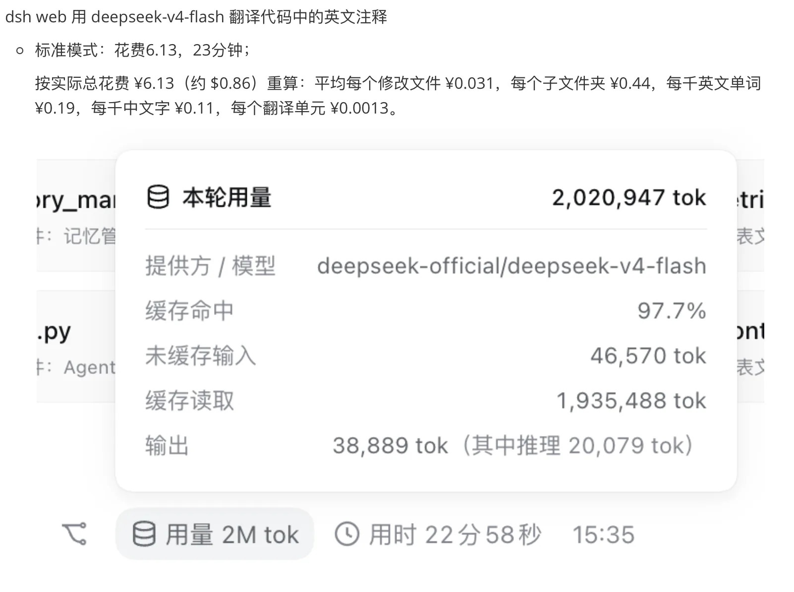
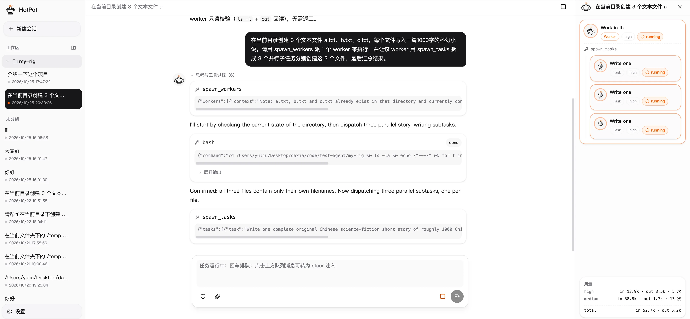

## 一、前情

最近在开发一个 agent，开发的原因是因为我在看 Deepseek Harness 的源码的时候用 kimi code 搭配 k3，翻译了几个包的代码注释，我发现就这一个翻译任务，用了我很多的周额度；

为了清晰的看到翻译任务的具体花费，我用了 Deepseek Harness 搭配 deepseek-v4-flash，一个兼具性能和花费的组合，大概是每千英文单词 ¥0.19；

这是一个远低于使用 kimi k3 的花费，于是我就有了问题：为什么要我来判断应该使用 deepseek flash 这种更便宜的模型去执行翻译任务？能不能让 agent 自己判断任务难度然后再使用不同档位的模型？

于是我调研了市面上的最流行的 code agent，几乎每个 agent 都有 subagent，可以根据不同的任务去分配给 subagent 执行，这解决不了我的问题，我要的是根据不同的任务难度分配不同档位的模型，达到 **一样的效果，更少的花费**；

只有 qwen code 和 opencode 支持自定义 subagent 使用的模型厂商；但是它们依然不是开箱就提供这个能力；

## 二、思考

随着大模型的能力不断提升，我一直在思考：人怎样才能不被 AI 替代？

通过不断的对 LLM 的了解和亲自体验，我得出了以下结论：

1. 涉及人的活动（体育锻炼、娱乐等）最不用担心；
2. AI 对人的替代不是一蹴而就的，LLM 本身的上下文有限、注意力有限；
3. Agent 提供了强大的执行能力，但是对任务的意图和判断，依旧需要人来确认；

按照这些结论，可以推断出实现 Agent 的第一性原理：

**提升人类的执行能力，节省人类的意图和判断，让人类的意图和判断能更好的执行；**

我来解释一下这句话，

LLM 来源于人，它的特性和人一样：任务多了会变得懒惰；

现在市面上大多数 agent 在“提升人类的执行能力”方面做的很多，但是人类的产出依然是有限的；

就用最火的 claude code 来说，claude code 确实帮助了程序员写了更多的代码，但还是需要程序员去给 claude code 制定目标，判断方向，需要人类参与其中，就决定了产出依旧是有限的；

如何提升这个有限的产出呢？节省人类的意图和判断，降低人类需要花费的脑力，这些节省出来的脑力可以增加新的产出；

回到我之前提到的翻译任务，我在翻译 dsh 的注释之前还要花费脑力想一下用哪个模型更省钱，这就让我接下来对 dsh 源码的学习少了一份脑力，少了一份注意力；

为什么不让 agent 自己去判断呢？

同样的，我要吐槽一下现在大部分 code agent 都有的 plan 模式，这是另一个没有节省人类的意图和判断的例子；

plan 模式的作用是：用户觉得某个任务需要计划一下再执行，然后就切到 plan 模式；那为什么不是 agent 自己来判断呢？这点小事还要人来判断？

## 三、提升 Agent 的上限

为了降低对人类意图和判断的消耗，提升用户使用 agent 的产出，于是我开发了这样一个 agent，它的主要思路在于三层 agent 的框架：

1. main agent 作为和用户交流的入口；
2. work agent 执行来自 main agent 分配的任务；
3. task agent 执行由 work agent 拆分的子任务；

三层agent之间的的逻辑如下：

main agent 按照任务难度决定直接回答、派发给 work agent 或者制定计划之后派发给 work agent，并且派发给 work agent 时还根据任务的不同难度分配不同档位的模型；work agent 按照任务是否能并行执行决定是否将任务派发给多个并行执行的 task agent 执行；

项目已经开源，可以直接访问：

[hotpot agent docs](https://dada-liu.github.io/hotpot-agent/index.html)

或者访问项目 github 地址：

[hotpot-agent](https://github.com/Dada-liu/hotpot-agent)

如果你有兴趣，可以给个 star 鼓励一下，也可以提 issue 或者 PR，给出你对 agent 的理解，让项目变得更好；
